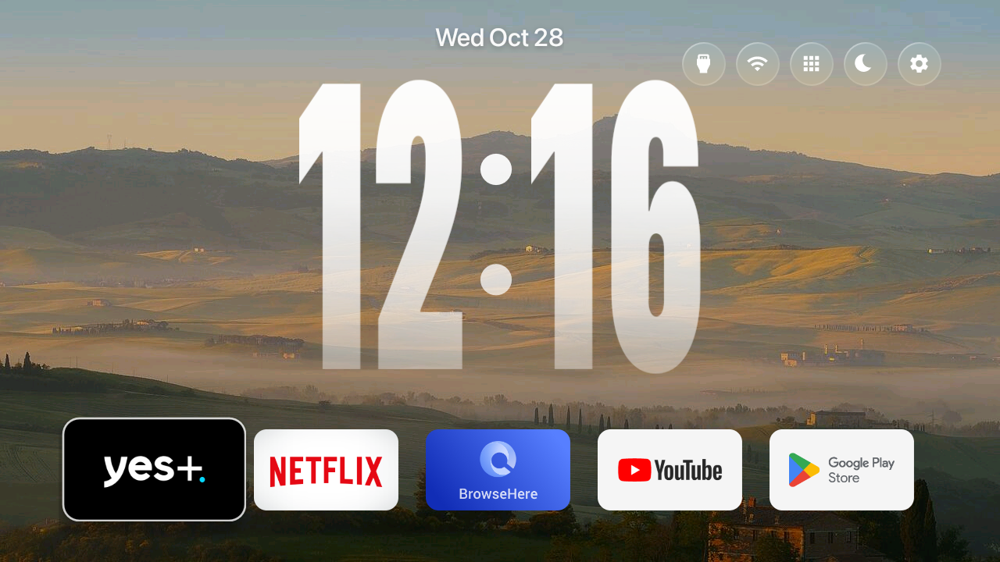
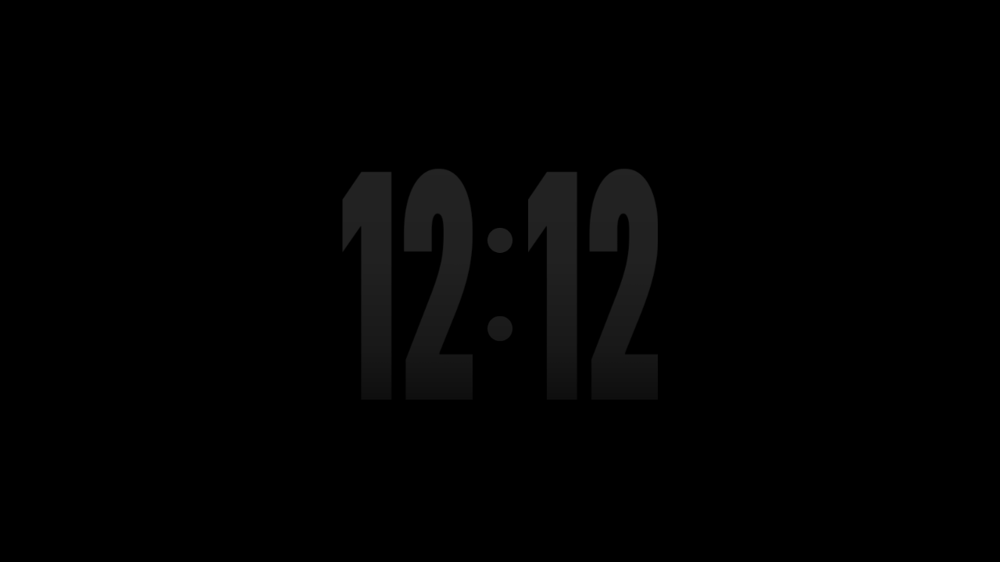
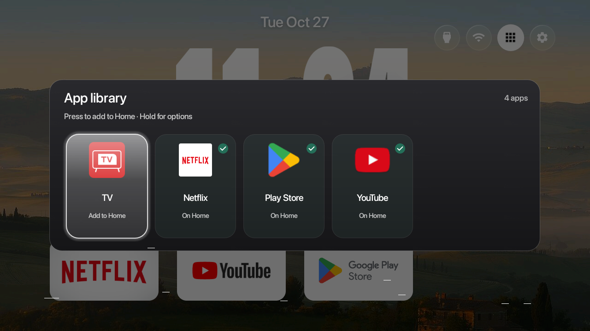
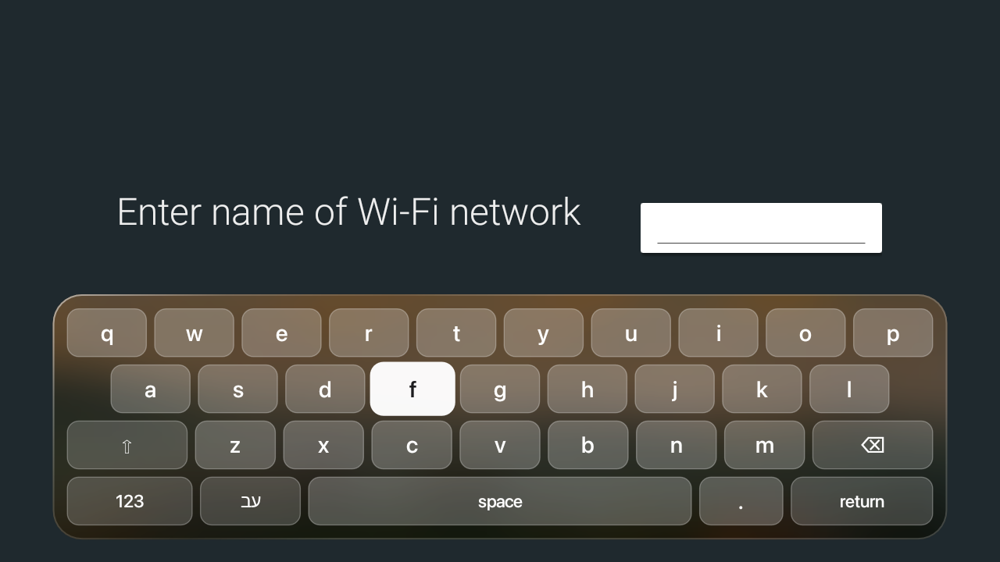

# ios-tv

An Apple-style (iOS 26 lock screen + tvOS Liquid Glass) home screen for a **TCL UnionTV** (Android TV 8.0.0, 1.5 GB RAM),
with the TV debloated and tuned to be fast. Built on [CleanYourTV](https://github.com/Gathin23/cleanyourtv) (MIT), using the
glass classes from [glassify-my-tv](https://github.com/skhode/glassify-my-tv) (MIT). The original CleanYourTV readme is
`README.cleanyourtv.md`.

| Home | Night mode | App library | Keyboard |
|---|---|---|---|
|  |  |  |  |

## What is in it
- **Launcher** (`launcher/`, package `com.gathin.tvhome`, ~580 KB, no network permission)
  - `TallClock`: the iOS 26 lock-screen clock (SF Pro Compressed Black stretched tall, round colon, glass gradient fill)
  - Liquid Glass buttons and panels (`LiquidGlass`, `GlassPillDrawable`, `Frost`: one small pre-blurred copy of the wallpaper, no live blur)
  - tvOS focus: bigger tile, white rim, lift; hold OK / Menu on a tile to Move, Replace or Remove
  - App library (grid button) to pin any installed app to Home
  - `GlassKeyboardService`: a glass on-screen keyboard (English, Hebrew, numbers), made the default again at each start
  - `NightModeActivity`: moon button, black screen with a very dim clock (Up/Down = brightness)
  - `HomeKeyService` redirect: TCL's firmware re-enables its stock launcher at every Home restart; the launcher sends it away
- **Theme** (`ios-tv/theme/`): `config.json` and a CC0 wallpaper, pushed with `tools/theme.sh ios-tv/theme`
- **Debloat lists** (`ios-tv/debloat/`): disable, never uninstall, applied with `tools/disable.sh`; undo with `tools/restore.sh`
- **Notes**: `ios-tv/TV-GUIDE.md` (what the owner can do with the remote), `ios-tv/removed-apps.txt`, `ios-tv/keyboard-undo.txt`

## Build
1. Fonts: Apple's SF fonts are **not** in this repo (license). Build them for your own use:
   `pip install fonttools` then `python ios-tv/scripts/make_fonts.py`
2. JDK 17 + Android SDK platform 34, then `launcher/build-and-install.sh` (Git Bash):
   `TV_HOST=<tv ip> STOCK_LAUNCHER=com.google.android.tvlauncher HOME_KEY_SERVICE=1 RESTORE_KEY_SERVICES=1 launcher/build-and-install.sh`
3. Theme: `TV_HOST=<tv ip> tools/theme.sh ios-tv/theme`
4. Speed: `ios-tv/scripts/compile.sh` (run on the TV with `tools/tv.py`) pre-compiles the apps; Netflix cold start went from 56 s to 1.7 s.

The TV needs Developer options and USB debugging on; turn them off again when done (`tools/adb-closed.py <tv ip>` checks the port).

## Licenses
MIT (see `LICENSE`). Wallpaper: CC0 (`ios-tv/theme/CREDITS.txt`). SF fonts belong to Apple and are not distributed here.
